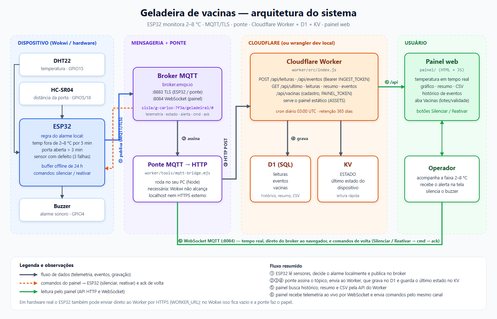

# Geladeira de vacinas — monitoramento IoT com ESP32 e Cloudflare

   

Sistema de monitoramento da cadeia de frio de vacinas (faixa **2–8 °C**). Um ESP32 lê temperatura, **umidade** e a porta da geladeira, decide **localmente** quando alarmar (funciona sem internet), toca um buzzer, publica por MQTT/TLS e guarda o histórico no Cloudflare D1, com um painel web em tempo real. Projeto da disciplina de IoT (Trabalho N2). Caderno completo: [`docs/caderno.md`](docs/caderno.md).



## Destaques
- **Alarme local e à prova de queda de internet:** temperatura fora da faixa, **abaixo de -3 °C (imediato)**, porta aberta por 3 min ou sensor com defeito; buffer de 24 h reenviado quando a rede volta.
- **Painel web** com temperatura e umidade ao vivo (MQTT/WebSocket), gráfico, resumo por intervalo, exportação CSV e cadastro de vacinas (lote/validade).
- **Backend serverless** no Cloudflare Workers com D1 (histórico) e KV (último estado), retenção automática de 365 dias.
- **Segurança:** TLS validado com CA raiz no dispositivo, comandos com anti-replay, tokens só em variáveis/segredos (veja abaixo).

```
firmware/  ESP32 (PlatformIO) + diagram.json/wokwi.toml     worker/  Cloudflare Worker, D1, KV
painel/    painel web (servido pelo Worker)                  docs/    caderno e evidências
```

## Como montar
- **Wokwi/placa:** DHT22 → GPIO15, HC-SR04 TRIG → 5 / ECHO → 18, buzzer → GPIO4 (ver `firmware/diagram.json`).

## Configurar segredos (nada disso vai para o Git)
1. `firmware/include/secrets.h.example` → `secrets.h` (Wi-Fi, broker MQTT, URL e token do Worker).
2. `firmware/include/certs.h.example` → `certs.h` (CA raiz do broker e do Worker; veja o comentário no arquivo).
3. `painel/config.example.js` → `config.js` (usuário do painel no broker, só com ACL de comando).
4. `worker/.dev.vars.example` → `worker/.dev.vars` (teste local). Em produção: `wrangler secret put INGEST_TOKEN`.
5. Troque `GRUPO` em `firmware/include/config.h` e `base` em `painel/config.js` pelo código do seu grupo.

## Rodar tudo local (Wokwi + Worker local + painel)
O Wokwi não alcança o `localhost` do PC, então o caminho dos dados é:
```
ESP32 (Wokwi) ──MQTT/TLS──▶ broker.hivemq.com ──▶ ponte (worker/tools/mqtt-bridge.mjs) ──HTTP──▶ Worker local (D1/KV) ──▶ painel
                                    └──────────── WebSocket (tempo real) ─────────────────────────────────────────────▶ painel
```
1. **Configuração usada no Wokwi** (`secrets.h`): Wi-Fi `Wokwi-GUEST`, broker público `broker.emqx.io:8883` sem usuário (`MQTT_USER`/`MQTT_PASS` = `NULL`), `WORKER_URL ""` (não envia por HTTP; quem grava no D1 é a ponte). `certs.h`: `CA_MQTT` = **DigiCert Global Root G2** (é a raiz do `broker.emqx.io`; confira com `openssl s_client -showcerts -connect broker.emqx.io:8883`).
2. **Grupo:** `GRUPO` em `config.h` e `base` em `painel/config.js` precisam ser iguais e **únicos** (o broker é público).
3. **Três processos**, cada um num terminal:
   ```bash
   cd firmware && pio run                 # compila; depois inicie/reinicie a simulação (VS Code + Wokwi ou wokwi-cli)
   cd worker && npm install && npm run db:local && npm run dev    # Worker + painel em http://localhost:8787
   cd worker && npm run ponte             # MQTT -> D1 (gráfico, resumo, CSV e histórico de eventos)
   ```
4. **Serial do ESP32**, em ordem: `[rede] Wi-Fi conectado (IP ...)` → `[rede] MQTT conectado (TLS) em broker.emqx.io:8883, topicos sis1a/<grupo>/geladeira1/#`. Se aparecer `[rede] MQTT falhou (estado N, TLS: ...)`: estado `-2` = falha de rede/TLS (veja a mensagem TLS e a CA), `-4` = timeout, `4`/`5` = usuário/senha recusados.
5. **Indicador no painel:** `conectando ao broker...` → `broker ok, aguardando ESP32...` → `ESP32 online`. `ESP32 não está publicando` = o painel está no broker mas não chega telemetria do seu grupo (simulação parada, grupo diferente ou ESP32 sem MQTT — veja o Serial).

Teste automático do Worker (com `npm run dev` rodando): `node test/smoke.mjs <INGEST_TOKEN do .dev.vars>` (use `BASE=http://localhost:8788` para outra instância).

## Regra do alarme (firmware/src/regra.h, valores em config.h)
| Condição | Dispara após | Desliga quando |
|---|---|---|
| temperatura > 8 °C | `ATRASO_TEMP_S` contínuos (produção 300 s; **demo 30 s**) | < 7 °C |
| temperatura < 2 °C | `ATRASO_TEMP_S` contínuos | > 3 °C |
| temperatura < -3 °C (congelamento) | **imediato** (sem atraso) | > 3 °C |
| porta (HC-SR04) > 20 cm | `ATRASO_PORTA_S` = 180 s | < 15 cm |
| sensor sem leitura | 3 leituras seguidas | volta a ler |

Voltar para a faixa zera o contador; reiniciar a simulação também. Buzzer: 2 kHz, 500 ms liga/desliga; "Silenciar" só é aceito com alarme ativo e cala por até 30 min; quando o alarme termina o silêncio é cancelado, então o próximo alarme toca (o alarme continua registrado). O relógio do alarme é o da simulação: se o Wokwi pausar, o contador para. O estado é publicado na hora em que muda; o alerta é repetido a cada 5 min enquanto o mesmo alarme durar.

## Painel
> **Umidade:** o DHT22 também mede a umidade relativa (`umid_pct`), exibida no painel e gravada no D1. Banco criado antes dessa versão: rode uma vez `npx wrangler d1 execute vacinas --local --persist-to .wrangler/state --file=migracao-umidade.sql` (ou `--remote` na Cloudflare).

Duas abas. **Monitoramento:** situação atual em destaque (temperatura grande sobre uma régua da faixa segura de 2 a 8 °C; a cor do bloco muda entre normal, fora da faixa sem alarme, alarme e ESP32 desconectado), comandos do buzzer, histórico em gráfico com dica ao passar o mouse, resumo por intervalo e eventos com filtro. **Vacinas:** cadastro (nome, lote, validade, tipo) no topo, situação do estoque, busca e lista pela validade.

- **Dados:** tempo real por MQTT/WebSocket; gráfico, resumo e CSV vêm de `/api/leituras` e `/api/resumo` (`?de=&ate=` até 31 dias, `?passo=segundo|minuto|hora`). Janelas prontas de 6 h, 24 h e 7 dias, ou período personalizado. CSV com `;` e vírgula decimal (abre direto no Excel pt-BR).
- **Honestidade do estado:** o firmware só alarma depois de alguns minutos fora da faixa; até lá o painel mostra a temperatura fora da faixa em âmbar, e nunca "dentro da faixa" com a temperatura fora dela. Sem dados novos por 40 s, o valor aparece esmaecido como "último valor conhecido".
- **Comandos:** "Silenciar" só habilita com alarme ativo e "Reativar" só com o buzzer silenciado; o resultado vem do ESP32 (ack).
- **Cadastro de vacinas:** local (`PAINEL_LIVRE=1` no `.dev.vars`) não pede chave; na Cloudflare exige a **chave do painel** (`PAINEL_TOKEN`), digitada uma vez e salva só no navegador. "Limpar tela" nos eventos só esconde da tela; o D1 guarda tudo.
- **Front:** `index.html`, `style.css` (tema claro/escuro automático, responsivo, respeita "reduzir movimento"), `app.js` (monitoramento), `vacinas.js` (aba Vacinas). A fonte Public Sans fica em `painel/fonts/` (sem depender de CDN); só a biblioteca MQTT vem da CDN.

## Publicar na Cloudflare (opcional, na sua conta)
`wrangler d1 create vacinas` e `wrangler kv namespace create ESTADO` → cole os ids em `worker/wrangler.toml` → `wrangler d1 execute vacinas --remote --file=schema.sql` → `wrangler secret put INGEST_TOKEN` → `wrangler deploy`. Para o ESP32 em hardware real enviar direto ao Worker, preencha `WORKER_URL` (https) e `CA_WORKER`. A ponte grava onde `WORKER_URL` (variável de ambiente) apontar; padrão `http://localhost:8787`.

## Testar as mensagens MQTT manualmente
Em **https://www.hivemq.com/demos/websocket-client/** (ou outro cliente MQTT) conecte em `broker.emqx.io`, porta `8084`, SSL marcado, sem usuário, e assine `sis1a/<grupo>/geladeira1/#`. Comando (não marque *Retain*; `nonce` sempre maior que o anterior):
```json
{"id":"teste1","cmd":"silenciar","min":5,"nonce":1}
```
A resposta chega em `.../ack`.

## Se o painel/ESP32/ponte não conectam ao broker
Teste o DNS: `nslookup broker.emqx.io`. Se devolver um IP `203.0.113.x` ou `2001:db8:...` (faixas de documentação), **a sua rede bloqueia aquele broker** (foi o que ocorreu com `broker.hivemq.com` numa rede). Troque de broker em 3 lugares: `MQTT_HOST` em `secrets.h`, `CA_MQTT` em `certs.h` (a CA raiz do novo broker) e `mqttUrl` em `painel/config.js` (WSS: emqx `wss://broker.emqx.io:8084/mqtt`, mosquitto `wss://test.mosquitto.org:8081`). A ponte lê o broker do `secrets.h` sozinha. Depois recompile e reinicie a simulação.

## Segurança do repositório
Nada sensível é versionado: `secrets.h`, `certs.h`, `painel/config.js` e `worker/.dev.vars` estão no `.gitignore`, e o repositório traz só os arquivos `*.example`. Tokens de produção ficam em `wrangler secret`. O broker público é só para demonstração; em produção use um broker com usuários e ACLs.

## Licença
MIT — veja [`LICENSE`](LICENSE).

## Limitações conhecidas
- **Wokwi não faz HTTPS para fora de forma confiável** (porta 443 trava no simulador) e não alcança o `localhost`: por isso a ponte MQTT. Em hardware real com Wi-Fi o envio direto funciona.
- **Broker público:** sem autenticação; qualquer um pode ler/publicar no seu grupo. Para produção use HiveMQ Cloud com usuários `dispositivo` e `painel` e ACLs (ver caderno).
- O PlatformIO local usa Arduino-ESP32 2.0.17; o código também compila na série 3.x (watchdog e LEDC tratados com `#if`).
